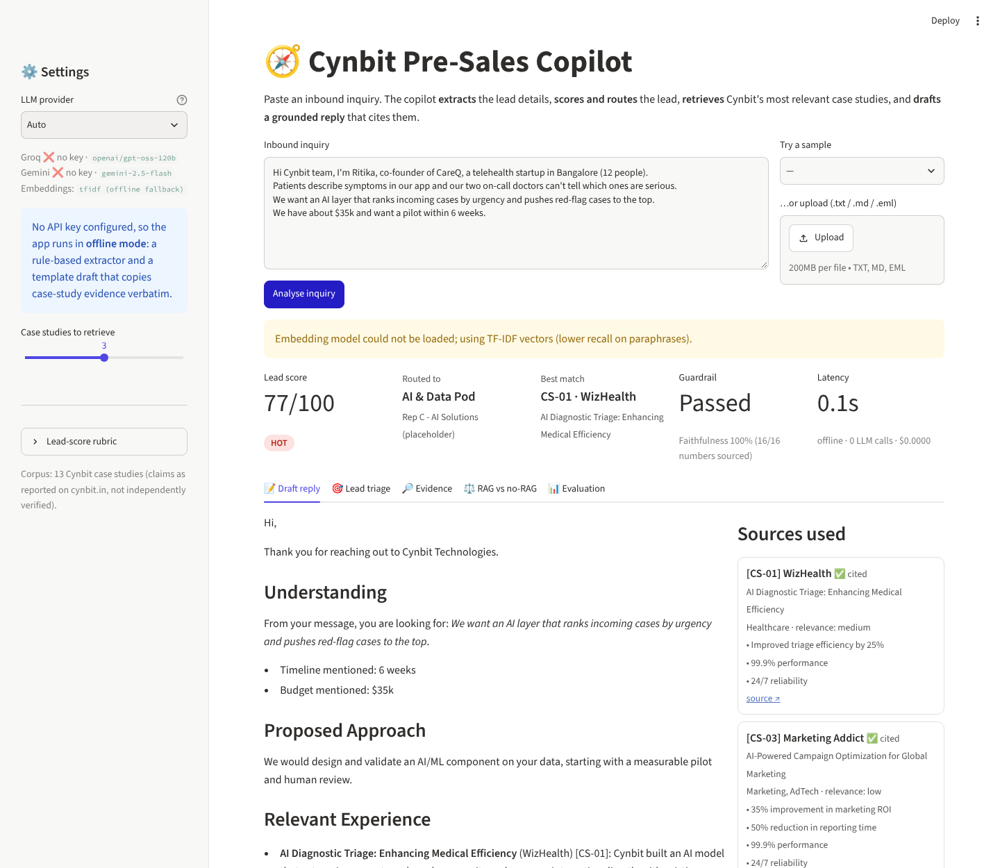
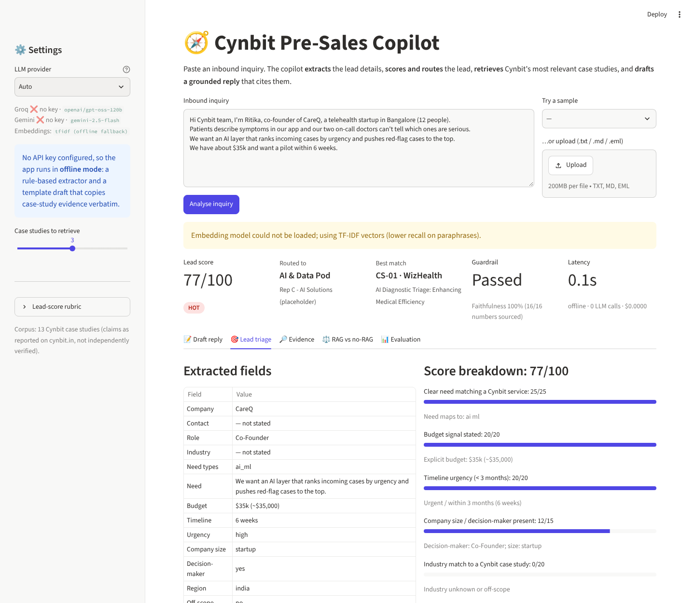
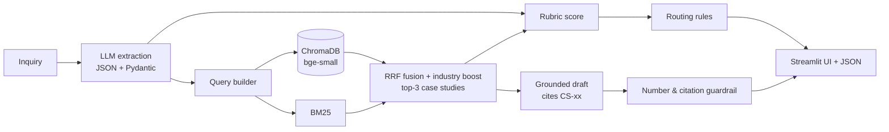

# 🧭 Cynbit Pre-Sales Copilot

**Lead triage + case-study RAG + grounded proposal drafting for Cynbit Technologies.**
AI/ML Engineer Intern assessment: *"Identify an AI opportunity for Cynbit"*, by **Kislay Mishra**.

> Cynbit's growth depends on turning inquiries into tailored proposals quickly. The Pre-Sales Copilot triages and scores each inbound lead, routes it, retrieves Cynbit's most relevant past work, and drafts a grounded proposal in seconds, using only verified case-study evidence.

| Deliverable | Link |
|---|---|
| 🌐 **Live demo** (Streamlit) | **https://cynbit-presales-copilot.streamlit.app** |
| 📄 AI Opportunity Report | [`docs/01_AI_Opportunity_Report.md`](docs/01_AI_Opportunity_Report.md) |
| 🛠️ Technical Approach Report | [`docs/02_Technical_Approach_Report.md`](docs/02_Technical_Approach_Report.md) |
| 📓 Colab backup | [`notebooks/Cynbit_PreSales_Copilot_Colab.ipynb`](notebooks/Cynbit_PreSales_Copilot_Colab.ipynb) · [Open in Colab](https://colab.research.google.com/github/kight7/Cynbit-POC/blob/main/notebooks/Cynbit_PreSales_Copilot_Colab.ipynb) |
| 📊 Evaluation results | [`eval/results/`](eval/results/) |
| 📚 Case-study corpus | [`Cynbit-Case-Studies/`](Cynbit-Case-Studies/) |



---

## What it does

1. **Paste or upload** an inbound inquiry (email, web form, LinkedIn message).
2. **Extract** structured fields with an LLM (JSON mode + Pydantic validation): industry, need types, budget (converted to USD from INR/EUR/GBP/AED), timeline, urgency, company size, decision-maker, region, off-scope flag, and missing information.
3. **Score** the lead 0–100 with a transparent, editable rubric ([`config/rubric.yaml`](config/rubric.yaml)) and **route** it to a team/rep with a rule engine ([`config/routing.yaml`](config/routing.yaml)).
4. **Retrieve** the top 3 of Cynbit's 13 case studies with hybrid search: ChromaDB dense vectors (bge-small) + BM25, fused with reciprocal-rank fusion and an industry boost.
5. **Draft** a reply grounded only in the retrieved case studies, citing them as `[CS-03]`, with a **Sources used** panel.
6. **Guardrail:** every number in the draft is checked against the sources and the inquiry; unsupported numbers are flagged ⚠️, and citations to cases that weren't retrieved are rejected.
7. **Evidence view:** retrieved chunks with scores, confidence, guardrail report, and full JSON export. A **RAG vs no-RAG** tab shows the hallucinations the grounding prevents.



## Architecture



**Stack:** Python · Streamlit · ChromaDB · FastEmbed (`BAAI/bge-small-en-v1.5`, ONNX, no PyTorch) · rank-bm25 · Pydantic v2 · Groq `openai/gpt-oss-120b` (primary) · Gemini `gemini-2.5-flash` (fallback).
**Resilience:** Groq → Gemini → **offline mode** (rule-based extractor + template draft that copies evidence verbatim), so the demo works even without an API key.

## Evaluation (30 labelled inquiries: 20 clear, 5 vague, 5 off-scope)

Full method and the latest numbers are in the [Technical Approach Report §6](docs/02_Technical_Approach_Report.md#6-evaluation); raw tables are in [`eval/results/`](eval/results/).
Metrics: extraction field accuracy · retrieval Hit@1/Hit@3/MRR plus an ablation (dense vs BM25 vs hybrid) · draft faithfulness · guardrail pass rate · latency · cost per request · **no-RAG baseline vs RAG** hallucination comparison.

```bash
python -m eval.run_eval              # uses the LLM if a key is set, otherwise offline
python -m eval.run_eval --mode offline
```

## Run it locally (macOS / Linux, Python 3.10+)

```bash
git clone https://github.com/kight7/Cynbit-POC.git && cd Cynbit-POC
python3 -m venv .venv && source .venv/bin/activate
pip install -r requirements.txt

# optional: add a free API key (console.groq.com or aistudio.google.com)
cp .streamlit/secrets.toml.example .streamlit/secrets.toml   # then edit it

streamlit run app.py
pytest -q                     # 15 tests, no API key needed
```

The first run downloads the ~67 MB embedding model. Without internet access it falls back to TF-IDF automatically.

## Project structure

```
app.py                      Streamlit UI
copilot/
  corpus.py                 parse + chunk the 13 case studies (speculative sections excluded)
  retriever.py              Chroma + BM25 hybrid retrieval, RRF, industry boost
  llm.py                    Groq/Gemini OpenAI-compatible client: JSON mode, retries, fallback, cost
  extraction.py             LLM extractor (schema + few-shot) and offline regex extractor
  scoring.py                rubric scoring + rule-based routing
  proposal.py               grounded prompt, no-RAG baseline, offline template
  guardrail.py              number + citation verification
  pipeline.py               orchestration, latency/cost tracking, graceful degradation
config/                     rubric.yaml · routing.yaml · taxonomy.yaml (editable without code)
eval/                       30-inquiry labelled set, evaluation harness, results
notebooks/                  Colab backup
docs/                       AI Opportunity Report · Technical Approach Report
tests/                      unit tests + headless UI test
Cynbit-Case-Studies/        source corpus (13 markdown case studies)
```

## Limitations and honest notes

- All case-study metrics are **Cynbit-reported on cynbit.in and not independently verified**. Tech stacks marked *inferred* are assumptions and are never cited as fact.
- The evaluation inquiries are synthetic and written by the author; real anonymised inquiries should replace them in a pilot.
- Sales-rep names in `routing.yaml` are placeholders.
- This is an independent assessment prototype, not affiliated with or endorsed by any organisation named in the case studies.
