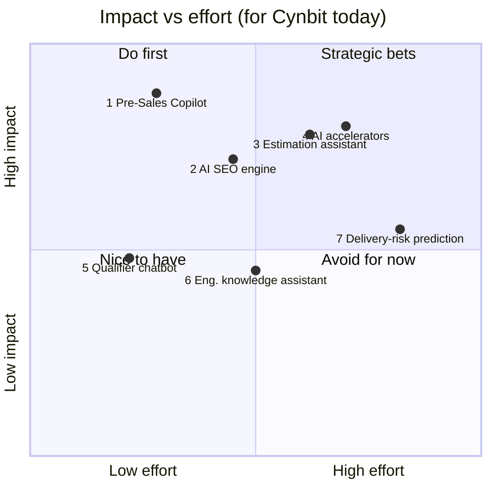

# AI Opportunity Report: Cynbit Technologies

**Prepared by:** Kislay Mishra · AI/ML Engineer Intern assessment · November 2026
**Companion documents:** [Technical Approach Report](02_Technical_Approach_Report.md) · [Proof of concept (repo root)](../README.md)

---

## 1. Executive summary

Cynbit is a young, fast-growing IT services company. It sells custom software projects across healthcare, fintech, retail, marketing, EdTech and other industries, and wins them through inbound inquiries and published case studies. In a services business at this stage, revenue depends directly on **how quickly and how well each inquiry becomes a credible, tailored proposal**.

I identified seven places where AI/ML can create value for Cynbit. The highest-value one with the lowest risk is a **Pre-Sales Copilot**. It reads an unstructured inquiry, extracts the lead details, scores and routes the lead with transparent rules, retrieves the most relevant of Cynbit's 13 published case studies, and drafts a reply that cites only verified evidence. I built a working proof of concept and evaluated it on 30 labelled inquiries (see the Technical Approach Report).

> *"Cynbit's growth depends on turning inquiries into tailored proposals quickly. The Pre-Sales Copilot triages and scores each inbound lead, routes it, retrieves Cynbit's most relevant past work, and drafts a grounded proposal in seconds, using only verified case-study evidence."*

---

## 2. Company analysis

### 2.1 What Cynbit is (public information)

| Aspect | What public sources show |
|---|---|
| Profile | Cynbit Technologies Pvt. Ltd., IT services and consulting. Founded in 2024 and headquartered in Jaipur, India. Business directories list a team of roughly 10–49 people (20+). |
| Services | Web development, app development, UX/UI design, custom software, SEO. The case studies add AI/ML, IoT, cloud migration, AR, real-time systems, payments and headless commerce. |
| Engagement model | Project-based custom development; directories list a minimum project size of about $1,000. |
| Proof assets | 13 published case studies on cynbit.in, covering 9+ industries. |

### 2.2 The case-study portfolio is Cynbit's main sales asset

| ID | Case (client as listed by Cynbit) | Industry | Quantified outcome reported by Cynbit |
|---|---|---|---|
| CS-01 | AI Diagnostic Triage (WizHealth) | Healthcare | Triage efficiency +25% |
| CS-02 | IoT Remote Patient Monitoring (Pragya Healths) | Healthcare / IoT | 40% fewer ER visits |
| CS-03 | AI Campaign Optimization (Marketing Addict) | Marketing | ROI +35%, reporting time −50% |
| CS-04 | Real-time Ticketing (Evento) | Entertainment | Stability during ticket drops (qualitative) |
| CS-05 | AR Virtual Try-On (Urban Wardrobe) | Fashion | none published |
| CS-06 | Food Transparency (Wild basil) | Food supply chain | none published |
| CS-07 | Legacy ERP Modernization (Sofiasa) | Enterprise software | none published |
| CS-08 | Adaptive Learning (EContentPrep) | EdTech | none published |
| CS-09 | Real-time Collaboration (Cloudy Tales) | SaaS | 50,000+ active writers |
| CS-10 | Headless Commerce (EliteVogue) | E-commerce | none published |
| CS-11 | Hyper-local SEO (TrendMart) | Retail | Organic traffic +140%, store visits +60% |
| CS-12 | Healthcare Cloud Migration (CarePlus) | Healthcare / cloud | none published |
| CS-13 | Cross-border Payments (GlobalPay) | Fintech | 2.4M+ DAU, sub-200 ms, 15 countries |

**What this tells us:**
1. **The work is broad and the team is small.** Few people cover 9+ industries and 10+ technology types. When an inquiry arrives, the person reading it may not know which past project is the best proof. That knowledge is spread across the team.
2. **Only 7 of 13 case studies have numbers.** Proposals need careful, honest use of evidence. Citing a metric that doesn't exist would be damaging.
3. **AI is already part of Cynbit's offering** (CS-01, CS-03, CS-08, fraud detection in CS-13). An internal AI tool also works as a live demo of Cynbit's capability for clients.

### 2.3 Where value is created and lost (services value chain)

```
Marketing → Inbound inquiry → Qualification → Proposal/estimate → Win → Delivery → Case study
                 ▲ slow, manual      ▲ inconsistent    ▲ rewritten each time            ▲ rarely reused
```

For a 20–50-person firm, the most constrained resource is senior people's time. Founders and leads end up qualifying leads and writing proposals instead of delivering. Inquiries also arrive unstructured (web forms, email, LinkedIn), with missing budgets, vague needs and a mix of good leads and off-scope requests.

**Assumptions (stated honestly):** I have no access to Cynbit's CRM, inquiry volumes or win rates. The pain points above are inferred from the public footprint and from how small services firms typically operate. Section 5 lists the metrics a pilot would use to confirm them.

---

## 3. Seven AI/ML opportunities

| # | Opportunity | What it does | Value driver | Data needed (availability) |
|---|---|---|---|---|
| **1** | **Pre-Sales Copilot** (lead triage + case-study RAG + proposal drafting) | Extract, score and route leads; retrieve relevant case studies; draft a grounded, cited reply | Faster response, higher win rate, consistent qualification | Case studies (**available now**), inquiry history (CRM) |
| 2 | AI SEO audit & local-content engine | Audits client sites and generates location and service pages from templates, with human review | Scales the SEO service line (CS-11 shows +140% organic traffic) | Search Console / GA data from clients |
| 3 | Scoping & estimation assistant | Breaks a requirement into modules and estimates effort from past projects | Fewer under-quoted projects, faster proposals | Past estimates vs. actuals (**needs collecting**) |
| 4 | Reusable AI accelerators for clients | Packaged triage/classification, fraud-scoring and recommendation services that reuse CS-01/CS-08/CS-13 patterns | New revenue; faster delivery | Client data per project |
| 5 | Website qualifier chatbot | Chat on cynbit.in that asks the missing questions (budget, timeline) and feeds #1 | More complete leads; 24/7 capture | Website traffic, FAQs |
| 6 | Internal engineering knowledge assistant | RAG over internal docs and repos; test and boilerplate generation | Delivery efficiency, onboarding | Internal repos and docs |
| 7 | Delivery-risk prediction | Flags projects likely to slip using Jira/Git/time-tracking signals | Margin protection | 6–12 months of project telemetry |

### 3.1 Impact/effort matrix



| # | Impact (1–5) | Effort (1–5) | Time to first value | Main risk |
|---|---|---|---|---|
| 1 | 5 | 2 | 2–3 weeks | Made-up claims in proposals (mitigated by grounding and a guardrail) |
| 2 | 4 | 3 | 4–6 weeks | Low-quality AI content penalised by search engines |
| 3 | 4 | 4 | 2–3 months | Too little historical estimate data |
| 4 | 4 | 4 | per client | Each client's data differs |
| 5 | 2 | 1 | 1–2 weeks | Annoying UX if it is pushy |
| 6 | 2 | 3 | 4–6 weeks | Keeping internal code private |
| 7 | 3 | 5 | 6+ months | Needs telemetry that probably doesn't exist yet |

---

## 4. Why I chose #1: the Pre-Sales Copilot

1. **It sits directly on the revenue path.** Every won project passes through qualification and a proposal. Faster, more relevant first replies mean more projects won.
2. **The data exists today.** The 13 case studies are enough to start. No client data or long collection period is needed.
3. **It fits Cynbit's own pitch.** Cynbit sells AI and workflow automation (routing, scoring, triage in CS-01). Using it internally makes it a sales demo too.
4. **It is safe by design.** Each step is checkable: scores come from an editable rubric, routing from a YAML rule table, and every number in a draft is checked against its sources. People stay in the loop, and nothing is sent automatically.
5. **It can be measured.** Extraction accuracy, retrieval Hit@3, draft faithfulness, latency and cost are all measured in the PoC. In production, time-to-first-response and proposal win rate are the business KPIs.
6. **It improves with use.** Each new project becomes a case study the copilot can retrieve, and #2, #3 and #5 build on the same infrastructure.

**Main risk:** an LLM could invent a metric ("we cut costs by 60%") that Cynbit never achieved. **Mitigation:** strict "use only the context" prompting, citations required for every claim ([CS-xx]), exclusion of this project's own speculative text from the index, and a post-generation guardrail that flags any number not found in the sources or the inquiry. The evaluation compares a no-RAG baseline against the RAG version to measure the effect.

---

## 5. Success metrics for a pilot

| Metric | Baseline (to measure) | 90-day target |
|---|---|---|
| Median time from inquiry to first tailored reply | measure 4 weeks pre-pilot | −50% |
| Share of replies citing ≥1 relevant case study | measure | > 80% |
| Rep edits needed before sending (self-reported 1–5) | n/a | ≤ 2 |
| Unsupported claims in sent replies | n/a | 0 |
| Lead-to-call conversion | measure | +15% |

---

## 6. Roadmap for opportunities #2 and #3

**#2: AI SEO audit & local-content engine** (builds on CS-11)
- *Weeks 1–2:* crawler + Lighthouse + Search Console connector that produces a ranked list of technical SEO issues.
- *Weeks 3–4:* location and service page generator (LLM + templates + the client's real store data), with mandatory human review and duplicate-content checks.
- *Weeks 5–6:* rank and traffic tracking dashboard. Success metric: organic sessions and store-visit actions per page.
- Reuses: the copilot's LLM client, prompt patterns and guardrail (no unsupported claims about the client's business).

**#3: Scoping & estimation assistant** (builds on #1)
- *Month 1:* start logging estimate vs. actual hours per module in the CRM or project tool. Without this data, ML estimation isn't possible.
- *Month 2:* LLM breaks a requirement into a standard module list, and a retrieval step finds similar past modules and their actual effort.
- *Month 3:* a simple regression or quantile model on logged data gives an effort range, shown next to the copilot draft. A senior lead always approves the estimate.
- Success metric: estimate error (MAPE) on new projects, and the share of projects that overrun the quote.

---

## 7. Sources and assumptions

- Cynbit public case-study pages (13 cases), summarised in this repository under `Cynbit-Case-Studies/`. All metrics are **Cynbit-reported and not independently verified**.
- Company profile details (founding year, location, team size, minimum project size): public business-directory listings (The Manifest, Village).
- I had no access to Cynbit's internal data (CRM, inquiry volumes, win rates). Pain points and targets are hypotheses for a pilot to test, not measured facts.
- Sales-rep names and team structure in the PoC routing table are placeholders.
