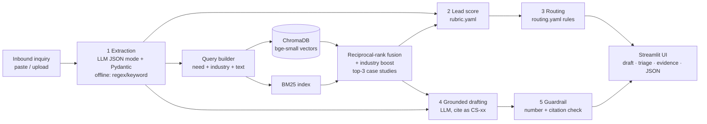

# Technical Approach Report: Cynbit Pre-Sales Copilot

**Prepared by:** Kislay Mishra · AI/ML Engineer Intern assessment · November 2026
**Code:** this repository · **Live demo:** see README · **Colab backup:** `notebooks/Cynbit_PreSales_Copilot_Colab.ipynb`

---

## 1. Problem and scope

Inbound inquiries arrive as unstructured text. Today a person has to read each one, judge fit and urgency, decide who should own it, look for relevant past projects, and write a tailored reply. The PoC automates the first draft of all five steps, keeps every decision explainable, and leaves a person in charge of sending.

**In scope:** single-inquiry analysis, 13-case-study knowledge base, transparent scoring and routing, grounded drafting, evaluation harness, a web UI, and an offline mode.
**Out of scope for the PoC:** CRM write-back, authentication, email ingestion, multi-language input. These are covered in the 30/60/90-day plan.

---

## 2. Architecture



| Module | File | Responsibility |
|---|---|---|
| Corpus & chunking | `copilot/corpus.py` | Parse the 13 markdown case studies into sections, metadata and metrics |
| Retrieval | `copilot/retriever.py` | Dense (Chroma) + sparse (BM25) hybrid, RRF fusion, case-level aggregation |
| LLM client | `copilot/llm.py` | One OpenAI-compatible client for Groq and Gemini; JSON mode, retries, fallback, cost tracking |
| Extraction | `copilot/extraction.py` | LLM extractor (schema + few-shot) and a deterministic offline extractor |
| Scoring & routing | `copilot/scoring.py` + `config/*.yaml` | Editable rubric and first-match rule engine |
| Drafting | `copilot/proposal.py` | Grounded RAG prompt, no-RAG baseline, offline template, off-scope decline |
| Guardrail | `copilot/guardrail.py` | Flags unsupported numbers and invalid citations |
| Orchestration | `copilot/pipeline.py` | Runs the stages, measures latency, tokens and cost, degrades gracefully |
| UI | `app.py` | Streamlit app with sources panel, score breakdown, evidence view, RAG vs no-RAG tab, evaluation tab |
| Evaluation | `eval/` | 30 labelled inquiries, metrics, ablation, failure cases |

**Graceful degradation:** Groq → Gemini → offline extractor and template. The public demo therefore always works, even if a key expires or a free-tier limit is hit. Every fallback shows a visible notice.

---

## 3. Model choices and why

| Component | Choice | Why | Alternatives considered |
|---|---|---|---|
| LLM (primary) | **Groq `openai/gpt-oss-120b`** | Very fast inference (good for a live demo), JSON mode, low list price (~$0.15 / $0.60 per 1M input/output tokens), free tier. Groq's recommended replacement for the retired `llama-3.3-70b-versatile`. | GPT-4-class APIs (higher cost); local 7B models (too weak for reliable JSON and grounded writing on a CPU host) |
| LLM (fallback) | **Gemini `gemini-2.5-flash`** via its OpenAI-compatible endpoint | Free tier and a different vendor, so it covers outages and rate limits | n/a |
| Embeddings | **BAAI/bge-small-en-v1.5 via FastEmbed (ONNX)** | Strong retrieval quality for its size (384-dim), runs on CPU, and needs no PyTorch, so it installs quickly on Streamlit Cloud. Uses bge's query instruction prefix. | all-MiniLM-L6-v2 (similar, slightly weaker on retrieval benchmarks); OpenAI embeddings (API cost and dependency) |
| Embedding fallback | TF-IDF (scikit-learn) | Works with no model download (air-gapped/CI) | n/a |
| Vector DB | **ChromaDB** (persistent, local) | Zero-ops, metadata filtering, easy to swap for pgvector/OpenSearch later | FAISS (no metadata), pgvector (needs Postgres) |
| Sparse retrieval | **BM25** (`rank_bm25`) + **reciprocal-rank fusion** | Inquiries contain exact domain terms ("EHR", "ticket drop", "SEO") that BM25 catches; dense vectors catch paraphrases. RRF needs no score calibration. | Cross-encoder reranker: skipped, because Hit@3 is already high on a 13-document corpus and it would add ~100 MB plus latency. Planned for when the corpus grows past ~100 cases. |
| Validation | **Pydantic v2** | Schema enforcement and normalisation of enums; validation errors are fed back to the LLM for one repair retry | n/a |

---

## 4. Data pipeline

1. **Source:** 13 case studies from cynbit.in, written as markdown with a fixed structure: Industry, Client need, Challenge, Solution, Tech stack, Outcome / metric, plus evidence labels (*verified text / expanded summary / inferred stack / unverified outcome*).
2. **Parsing** (`corpus.py`): extracts metadata (case ID `CS-01..13`, client, industry mapped to a shared taxonomy, solution type, source URL) and pulls quantified metrics from the Outcome section.
3. **Chunking:** one chunk per evidence section plus one *summary* chunk per case, giving **78 chunks**. Each chunk carries `{case_id, title, client, industry, solution_type, source_url, metric, section}`.
4. **Leakage control:** sections written by this project ("AI/ML opportunity", "Source notes") are **not indexed**, so the generator can never cite our own speculation as Cynbit's work. Inferred tech stacks are relabelled "not confirmed by Cynbit", and the prompt forbids presenting them as fact.
5. **Indexing:** chunks are embedded and stored in a persistent Chroma collection (cosine), with a parallel BM25 index. The index is rebuilt at start-up (it takes about a second for 78 chunks), so it can never go out of sync with the markdown.
6. **Retrieval:** query = extracted need summary + industry + need types + raw inquiry. Dense and BM25 rankings are fused with RRF (k=60). Chunk scores are aggregated to case level (best chunk + 0.5 × second best), cases sharing the lead's industry get ×1.35, and the top 3 are returned with their Outcome chunk always attached so metrics are available for citation.

---

## 5. Prompt engineering

**Extraction prompt** (`extraction.py`)
- Role: *pre-sales analyst at Cynbit*, with Cynbit's service lines listed.
- An explicit schema with **controlled vocabularies** for industry, need types and region (the same taxonomy used by retrieval and routing).
- Rule: **"Use null when a fact is not stated. Never guess."** Plus definitions for urgency and company-size buckets and FX conversion rules (INR lakh/crore, EUR, GBP, AED to USD).
- Today's date is injected so relative timelines ("by March") can be turned into months.
- **Two few-shot examples:** one rich inquiry and one deliberately vague one, which teaches the model to return nulls instead of hallucinating.
- JSON mode, then Pydantic validation; on failure the error is sent back for a repair retry (max 2).

**Grounded proposal prompt** (`proposal.py`)
- "Statements about Cynbit's past work must come ONLY from the CONTEXT and be followed by a citation like [CS-03]."
- "Only use numbers that appear in the CONTEXT or the client's inquiry. No invented prices, team sizes, durations or percentages."
- "Items marked draft / inferred / not confirmed are not achieved results."
- "If the context is not relevant, say so and ask clarifying questions."
- Fixed sections: Understanding · Proposed Approach · Relevant Experience · Timeline (phases only, no invented week counts) · Next Steps (discovery call plus 2–4 questions taken from the extractor's `missing_info`).

**Guardrail** (`guardrail.py`): after generation, every numeric token is normalised and checked against the retrieved context and the inquiry. List markers, phase labels and citation IDs are ignored. Unsupported numbers are highlighted ⚠️ in the UI. Citations pointing to case studies that weren't retrieved are flagged as invalid. `faithfulness = sourced numbers / all numbers`.

**Scoring and routing** are deliberately **not** done by the LLM. They are deterministic functions of the extracted fields and YAML config: explainable, auditable, and editable by Sales Ops.

| Rubric factor | Points |
|---|---|
| Clear need matching a Cynbit service | 25 (vague 12) |
| Budget signal stated | 20 (soft signal 10) |
| Timeline urgency < 3 months | 20 (3–6 mo 10, longer 5) |
| Company size / decision-maker present | 15 (8 + up to 7) |
| Industry match to a case study | 20 (related 10) |

Tiers: **Hot ≥ 70**, **Warm 40–69**, **Cold < 40**. Routing: first match wins (off-scope → Inbound Desk, cold → Nurture, healthcare/fintech pods, AI & Data pod, commerce, growth, international, default).

---

## 6. Evaluation

**Dataset:** `eval/inquiries.jsonl`, 30 synthetic inquiries I wrote and labelled **before** running the system: 20 clear (spread across all 13 case studies, several currencies and regions), 5 vague, 5 off-scope. Labels: industry, urgency, primary need, budget present, decision-maker present, off-scope, and the expected best case study(ies).

**Reproduce:** `python -m eval.run_eval` (it uses the LLM when a key is set, otherwise offline). It writes `eval/results/summary_*.md`.

<!-- EVAL:START -->
_Generated by `python -m eval.run_eval` on 2026-11-07. Full tables: `eval/results/`._

| Metric | Offline mode (rules + `tfidf (offline fallback)`) |
|---|---|
| Extraction: Industry | 88% |
| Extraction: Primary need type detected | 64% |
| Extraction: Urgency | 96% |
| Extraction: Budget present | 90% |
| Extraction: Decision-maker present | 97% |
| Extraction: Off-scope flag | 97% |
| **Retrieval Hit@3** | **96%** |
| Retrieval Hit@1 / MRR | 88% / 0.92 |
| Draft faithfulness (numbers traceable to sources) | 100% |
| Drafts passing guardrail | 100% |
| Latency p50 / p95 | 15 ms / 19 ms |
| Tokens / cost per inquiry | 0 / $0.0000 |

**Retrieval ablation (Hit@3, embedding backend: tfidf (offline fallback)):** Dense only: 96% · BM25 only: 92% · Hybrid (RRF): 96% · Hybrid + industry boost (default): 100%

_No-RAG vs RAG comparison: run with an API key to generate._
<!-- EVAL:END -->

### Failure cases worth showing
- **"Wedding season" trap (Q20):** an ethnic-wear brand asking for a virtual try-on mentions *"launch by the wedding season"*. The offline keyword extractor sees "wedding", finds no known industry ("kurta"/"saree" aren't in its vocabulary) and wrongly marks the inquiry off-scope. This is exactly the brittleness the LLM extractor exists to fix, and it is why the off-scope decision only ever produces a *suggested* polite reply that a person reviews.
- **Vague inquiries (Q21–Q25)** correctly score Cold and route to Nurture. Their drafts ask clarifying questions instead of pitching.
- **Industry overlap:** eyewear (Q05) is labelled *fashion* but extracted as *e-commerce*. Both are defensible, and retrieval still finds the AR try-on case.

### Honest caveats
- The 30 inquiries were written by the same person who built the system, so they are likely easier than real inbound mail. Real inquiries (anonymised) should become the test set in the first two weeks of a pilot.
- 13 documents is a small corpus, so Hit@3 is easy to max out. The ablation and Hit@1/MRR are more informative.
- The number guardrail checks *values*, not *meaning*: "25%" is accepted even if it is attached to the wrong claim. Citation-level entailment checking (an NLI model or an LLM judge) is the next step.

---

## 7. Limitations

- **Unverified source claims:** all metrics are Cynbit-reported on its website. The copilot states this and never strengthens a claim.
- **Single-turn:** there is no memory of previous emails with the same lead (CRM integration would fix this).
- **English only** for now. Hindi/Hinglish inquiries are plausible in Cynbit's market.
- **Free-tier rate limits** on Groq/Gemini. A production deployment needs a paid key or a self-hosted model.
- **PII:** inquiries contain names and contact details and are sent to a third-party LLM API (see the plan below).

---

## 8. How it plugs into Cynbit's stack

```
Website form / Gmail / LinkedIn ──► webhook ──► FastAPI service (this pipeline, containerised)
                                                     │
               ┌─────────────────────────────────────┼──────────────────────────────┐
               ▼                                     ▼                              ▼
     CRM (HubSpot/Zoho/Salesforce):        Slack/Teams alert to the          Draft saved as an email
     lead fields, score, owner, notes      routed owner (Hot = instant)      draft for human review
```

- **Cloud (AWS, as used in CS-12):** ECS Fargate or Lambda for the API, S3 for case-study markdown (an S3 upload triggers re-indexing), and pgvector on RDS or OpenSearch to replace local Chroma. Secrets live in AWS Secrets Manager, logs in CloudWatch.
- **The copilot's JSON output maps directly onto CRM fields**, and `routing.yaml` maps onto CRM owner assignment.

---

## 9. 30/60/90-day productionisation plan

| Phase | Deliverables |
|---|---|
| **Days 1–30: pilot** | Shadow mode: copilot runs on every real inquiry while reps still reply manually. Collect 100+ real anonymised inquiries as a test set. Add an API (FastAPI) and Google/Microsoft SSO for internal users. Log rep edits to drafts as the quality signal. |
| **Days 31–60: integrate** | CRM write-back (fields, score, owner) and Slack alerts for Hot leads. Add a PII-redaction step before the LLM call (names, emails, phones masked and restored after). Store prompts/responses with 30-day retention. Choose a paid LLM tier with a data-processing agreement, or a self-hosted model. |
| **Days 61–90: harden** | Monitoring dashboard (latency, cost, guardrail flag rate, retrieval confidence, fallback rate). Weekly eval run in CI on the growing test set. Re-calibrate rubric weights against actual won/lost outcomes (logistic regression on CRM history). Add a reranker and citation-level entailment checks. Extend to opportunity #5 (website qualifier chat). |

**Cost:** ≈ 2 LLM calls and ~3–4k tokens per inquiry, about **$0.001 per inquiry** at Groq list prices (measured values are in the evaluation table). Even 1,000 inquiries a month costs about a dollar. Infrastructure (one small container plus a database) is the main cost.
